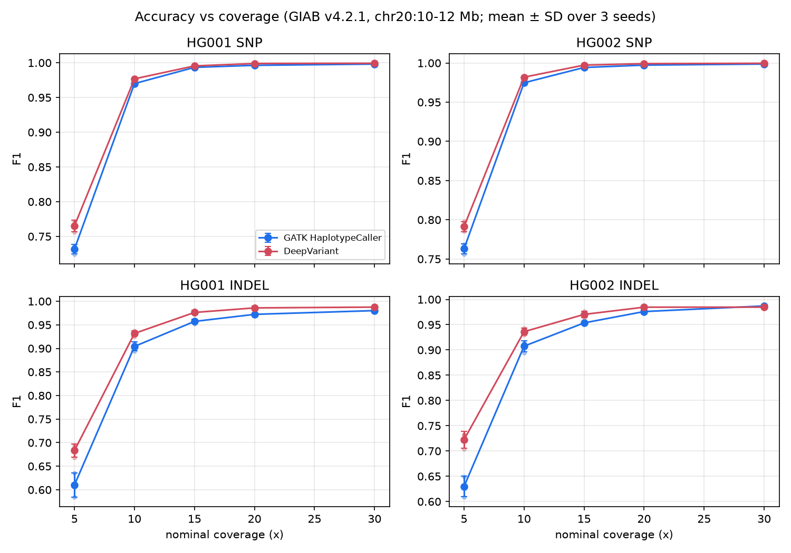
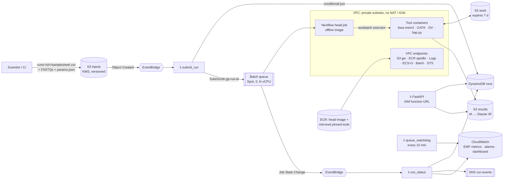

<h1 align="center">genomics-platform-aws</h1>

<p align="center">
  <b>Event-driven germline variant calling on Nextflow, Terraform and AWS Batch, with a reproducible, statistically rigorous GIAB benchmark.</b>
</p>

<p align="center">
  <a href="https://github.com/yogvidwankhede/genomics-platform-aws/actions/workflows/ci.yml"></a>
  
  
  
  
  
  
  <a href="LICENSE"></a>
</p>

<p align="center">
  <a href="#highlights">Highlights</a> ·
  <a href="#architecture">Architecture</a> ·
  <a href="#quickstart-local-no-aws">Quickstart</a> ·
  <a href="#research-benchmark">Research</a> ·
  <a href="#deploying-to-aws">Deploy</a> ·
  <a href="#security-model">Security</a> ·
  <a href="#cost">Cost</a> ·
  <a href="docs/README.md">Docs</a>
</p>

A production-style genomics platform: an uploaded samplesheet goes **S3 → EventBridge → Lambda →
AWS Batch (Spot)**. There, an offline Nextflow head job runs
**FastQC/fastp → BWA-MEM2 → MarkDuplicates → GATK HaplotypeCaller and/or DeepVariant → bcftools
→ hap.py vs GIAB → MultiQC** in a NAT-less VPC. Run state is tracked in **DynamoDB** and served
by an **IAM-authenticated API**. Everything is **Terraform**, shipped through **GitHub Actions
with OIDC**, and documented like a platform team would (runbook, ADRs, post-mortem, cost model).

> Every number in this README was measured and is traceable in **[RESULTS.md](RESULTS.md)**
> (local, CI, or AWS). Anything not measured is labelled as such.

## Highlights

**Research findings** ([full report](docs/report.md); 4 GIAB samples, 56 call sets, block-bootstrap CIs):

| Finding | Evidence |
|---|---|
| At ~30x, GATK and DeepVariant are **statistically indistinguishable** on the same variants | SNP F1 0.996–0.9996, INDEL F1 0.980–0.997; paired exact McNemar p ≥ 0.125 for all 4 samples |
| DeepVariant's advantage is a **low-coverage effect** | significant in every replicate at 5x and 10x (p ≤ 0.005); at 5x INDEL F1 +7–9 points |
| **94–100% of SNP errors** sit in GIAB difficult regions (10% of the sequence) | low-mappability SNP F1 0.85 (GATK) vs 0.94 (DeepVariant) |
| Trio Mendelian errors attributable to the caller: **GATK 3, DeepVariant 1** | 13 further violations are shared with the independent truth sets (sample-level, not caller error) |
| DeepVariant costs about **2.1x** GATK's CPU per sample, and its cost barely falls with depth | Nextflow traces, 8.45 CPU-h for the full matrix |
| Results are **byte-identical** across reruns, 2 vs 8 threads and **laptop vs AWS** | holds only with BWA-MEM2 `-K` fixed: without it 22 read pairs align differently by thread count ([ADR-0006](docs/adr/0006-deterministic-alignment-and-pinned-environment.md)) |

**Platform, measured on a real AWS account** (Batch Spot, Free plan, then torn down):

| | |
|---|---|
| GIAB HG001 on AWS | SNP F1 **0.9981**, INDEL F1 **0.9802**, identical to the local run; 14/14 tasks, 11 m 44 s |
| Event-driven chain | S3 upload → EventBridge → Lambda → DynamoDB → Batch → status Lambda, working end to end |
| Resume from the S3 task cache | 14/14 tasks cached, **14.5 s** instead of 11 m 44 s |
| API | SigV4-signed requests get 200; **unsigned requests get 403** |
| Teardown | `make destroy`: **142 resources destroyed**, verified empty |
| Hardening from the real deployment | 9 defects found only in the cloud, each fixed with a regression guard ([post-mortem](docs/postmortem-first-aws-deployment.md)) |

<p align="center"></p>

## Architecture



| Layer | Where | Notes |
|---|---|---|
| Pipeline | `pipeline/` | FastQC/fastp → BWA-MEM2 → MarkDuplicates → HaplotypeCaller **or** DeepVariant → bcftools norm/filter → hap.py → MultiQC; nf-schema; nf-test |
| Infra | `infra/` | `bootstrap` (state + OIDC) and modules `network`, `storage`, `ecr`, `iam`, `batch`, `trigger`, `observability`, composed once in `platform` and parameterised by `envs/{dev,prod}.tfvars` |
| Orchestration | `services/trigger` | submit / status / watchdog Lambdas, one shared SubmitJob builder (also used by the operator CLI) |
| API | `services/api` | FastAPI on Lambda: `/runs`, `/runs/{id}`, `/runs/{id}/qc`, `/runs/{id}/variants` |
| Head image | `containers/nextflow-head` | Nextflow 26.10.7 with pipeline and plugins baked in; `NXF_OFFLINE=true` |
| CI/CD | `.github/workflows` | PR gate, OIDC plan comments, gated apply, release-please |
| Research | `research/` | experiment design, reproducibility runs, `gp_research` statistics (bootstrap, McNemar, Mendelian) |
| Ops | `docs/` | [runbook](docs/runbook.md), [ADRs](docs/adr/README.md), [cost model](docs/cost-model.md), [post-mortem](docs/postmortem-first-aws-deployment.md), [report](docs/report.md) |

## Quickstart (local, no AWS)

Requirements: Docker (amd64 emulation on Apple Silicon), Java 17+, Nextflow ≥ 25.10, nf-test 0.9.x,
Terraform ≥ 1.10, Python 3.13.

```bash
make test-pipeline
```

```bash
make benchmark
```

```bash
CALLER=deepvariant make benchmark
```

```bash
make venv && make test-trigger test-api lint-python
```

```bash
make tf-check
```

- `make test-pipeline` runs nf-test (100 kb GIAB slice committed in `pipeline/tests/data`, about 2 min)
- `make benchmark` fetches chr20:10-12 Mb and runs the GIAB benchmark with GATK (about 2 min after downloads)
- `make tf-check` runs fmt, validate, tflint, checkov and terraform test with no AWS credentials

Results land in `data/runs/benchmark-local-<caller>/`: `benchmark/HG001/*.summary.csv`
(hap.py), `multiqc/multiqc_report.html`, `summary/HG001.run_summary.json`, and
`pipeline_info/` (trace, timeline, report, DAG).

## Research benchmark

The pipeline runs the whole experiment matrix (samples × depths × seeds × callers) as **one
Nextflow run**: each samplesheet row can carry its own truth set and a seeded downsampling
fraction, and `--caller gatk,deepvariant` calls the same alignments with both callers.

| Design | |
|---|---|
| Samples | HG001 and the GIAB Ashkenazi trio HG002/HG003/HG004 (30x HiSeq X, chr20:10–12 Mb, NISTv4.2.1 truth) |
| Coverage titration | 5x, 10x, 15x, 20x (3 seeds each) and 30x; 28 alignments, 56 call sets, 448 tasks |
| Statistics | GIAB v3.6 stratifications, 50 kb block-bootstrap 95% CIs, exact McNemar paired tests, trio Mendelian decomposition |
| Cost and reproducibility | CPU-hours from Nextflow traces; repeat, thread-count, BWA-MEM2 `-K` and laptop-vs-AWS comparisons |

Reproduce everything locally ($0 cloud cost; several hours on a laptop):

```bash
make research
```

Run the statistics unit tests:

```bash
make test-research
```

Code lives in [`research/`](research) (data fetch, pre-registered design, `gp_research`
statistics package with tests). The write-up is [`docs/report.md`](docs/report.md).

## Deploying to AWS

Step-by-step, including the cost check before every apply, is in
[docs/runbook.md](docs/runbook.md#deploy). Run `make preflight ENV=dev` first: it is
read-only and checks the account limits that broke the first deployment. In short:

```bash
make bootstrap-plan
make plan ENV=dev
make apply ENV=dev CONFIRM=yes
make stage-awscli mirror-images push-head
MODE=event make submit-benchmark ENV=dev
make destroy ENV=dev
```

1. `make bootstrap-plan` (then `bootstrap-apply`) creates the state bucket and GitHub OIDC roles, once per account
2. `make plan ENV=dev` writes a plan file and prints the cost estimate
3. `make apply ENV=dev CONFIRM=yes` refuses to run without `CONFIRM=yes`
4. `make stage-awscli mirror-images push-head` stages the AWS CLI and pushes images to ECR (no NAT, so the instances can only pull from ECR)
5. `MODE=event make submit-benchmark ENV=dev` uploads the samplesheet last, which triggers the run
6. `make destroy ENV=dev` tears it all down in one command

## Security model

- **No static credentials.** CI uses GitHub OIDC. PRs get a read-only plan role; applies use
  per-environment roles whose trust policy matches `repo:…:environment:<env>`, so prod can
  only be applied after the `prod` Environment's reviewers approve.
- **Network:** private subnets only, no internet or NAT gateway. AWS APIs go through VPC
  endpoints. Batch instances have no ingress; egress is HTTPS to the VPC and the S3 prefix list.
- **Least privilege:** separate roles for instances (image pulls), the Nextflow head
  (Batch orchestration and `iam:PassRole` on the task role only), tasks (S3 data only), and
  each Lambda. IAM writes from CI are limited to `gp-*` names.
- **Data:** every data bucket uses SSE-KMS (a CMK with rotation), versioning, public access
  blocked, a TLS-only policy and access logging. DynamoDB, SNS, SQS, ECR, EBS, CloudWatch Logs
  and the SSM config are encrypted with the same key.
- **Compute:** IMDSv2 required with hop limit 1, so containers can't read instance
  credentials. Encrypted EBS. Images are immutable-tagged, scanned on push in ECR, and
  Trivy-gated in CI.
- **Input safety:** run IDs and parameters are validated. A user's `params.json` cannot
  override platform-owned parameters (`input`, `outdir`, queue, role, registry).
- **Audit:** CloudTrail (multi-region, log validation, KMS) and VPC flow logs (REJECT).
- **Data policy:** public GIAB data only; no PHI.

## Cost

Cost guard-rails are Spot only, scale to zero, a vCPU ceiling (4 in dev), no NAT, a 4 h head-job
timeout, a $10/month AWS Budget with SNS and email alerts, and a one-command `make destroy`.
The interface endpoints are the only thing billed while idle (8 × $0.01/h in dev), so
**destroy dev when you are done**.

| | Value | Source |
|---|---|---|
| Estimated cost per benchmark run | ≈ $0.23 (pessimistic: one 8-vCPU Spot instance for 1 h) | `scripts/cost_estimate.py` (list-price assumptions) |
| Estimated idle cost while deployed | ≈ $0.09/h (dev) | same |
| **Measured** cost of the AWS session (~1.5 h up, 4 attempts, 1 full run) | **not yet measured** (Cost Explorer lags ~24 h) | will be added to RESULTS.md |
| Measured compute of the AWS run | 0.096 allocated CPU-hours; 88% of task wall time was overhead | Nextflow trace (RESULTS.md) |

Details: [docs/cost-model.md](docs/cost-model.md).

## Repository layout

```
pipeline/            Nextflow pipeline, configs, schemas, nf-test suites + 100 kb test data
infra/bootstrap/     state bucket + GitHub OIDC roles (run once per account)
infra/modules/       network, storage, ecr, iam, batch, trigger, observability
infra/platform/      the one root module; envs/{dev,prod}.{tfvars,backend.hcl}
services/trigger/    Lambda handlers + shared SubmitJob builder + operator CLI
services/api/        FastAPI read API
containers/          offline Nextflow head image
research/            M7 benchmark: data fetch, matrix design, reproducibility runs,
                     gp_research statistics package (+ tests), config
scripts/             data fetch, image mirroring, packaging, cost estimate, preflight
docs/                report, runbook, ADRs, cost model, post-mortem, branch protection
```

## Contributing, security and citation

- [CONTRIBUTING.md](CONTRIBUTING.md): setup, conventions (Conventional Commits, pinned
  containers, nf-test), PR checks
- [SECURITY.md](SECURITY.md): private vulnerability reporting and scope
- [CITATION.cff](CITATION.cff): use GitHub's "Cite this repository" button
- [CHANGELOG.md](CHANGELOG.md): release-please, semantic versioning

## License

[MIT](LICENSE). Data: GIAB (NIST) and Google Brain Genomics public datasets, used under their
terms. Public data only; no PHI.
