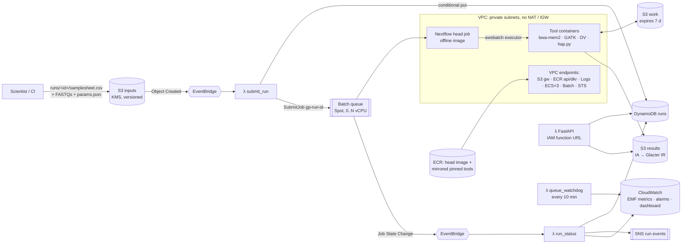

# genomics-platform-aws

[](https://github.com/yogvidwankhede/genomics-platform-aws/actions/workflows/ci.yml)

An event-driven germline variant-calling platform: a **Nextflow DSL2** pipeline validated
against the **GIAB HG001** truth set with **hap.py**, running on **AWS Batch (Spot)** in a
NAT-less VPC built with **Terraform**, triggered by S3 uploads, and shipped through
**GitHub Actions with OIDC**.

> **Status:** built, tested, and **run end to end on AWS** (a new Free-plan account, Batch Spot,
> 2026-11-23), then torn down. Every number below comes from [RESULTS.md](RESULTS.md), which
> records where each one was measured. The research benchmark (M7) is in
> [docs/report.md](docs/report.md).

## Headline results

GIAB HG001, chr20:10-12 Mb, 30x HiSeq X, NISTv4.2.1 truth, hap.py on PASS calls:

| Caller | Where | SNP F1 | INDEL F1 | Wall time |
|---|---|---:|---:|---:|
| GATK HaplotypeCaller 4.7.0.0 | laptop (Docker) | 0.9981 | 0.9802 | 1 m 57 s |
| GATK HaplotypeCaller 4.7.0.0 | **AWS Batch Spot**, event-triggered platform | **0.9981** | **0.9802** | 11 m 44 s |
| DeepVariant 1.10.0 | laptop (Docker) | 0.9992 | 0.9876 | n/a |

- **AWS vs local:** identical hap.py results from the same FASTQs.
- **AWS wall time:** 88% of task time on AWS was scheduling, instance start-up and S3 staging,
  which is the real cost driver at this data size.
- **Resume:** a rerun was served entirely from the S3 task cache (14/14 cached, 14.5 s).
- **Teardown:** the stack was destroyed with one command (142 resources).
- **Post-mortem:** what broke on the first real deployment and how each issue is now guarded:
  [docs/postmortem-first-aws-deployment.md](docs/postmortem-first-aws-deployment.md).

## Architecture



| Layer | Where | Notes |
|---|---|---|
| Pipeline | `pipeline/` | FastQC/fastp → BWA-MEM2 → MarkDuplicates → HaplotypeCaller **or** DeepVariant → bcftools norm/filter → hap.py → MultiQC; nf-schema; nf-test |
| Infra | `infra/` | `bootstrap` (state + OIDC) and modules `network`, `storage`, `ecr`, `iam`, `batch`, `trigger`, `observability`, composed once in `platform` and parameterised by `envs/{dev,prod}.tfvars` |
| Orchestration | `services/trigger` | submit / status / watchdog Lambdas, one shared SubmitJob builder (also used by the operator CLI) |
| API | `services/api` | FastAPI on Lambda: `/runs`, `/runs/{id}`, `/runs/{id}/qc`, `/runs/{id}/variants` |
| Head image | `containers/nextflow-head` | Nextflow 26.10.7 with pipeline and plugins baked in; `NXF_OFFLINE=true` |
| CI/CD | `.github/workflows` | PR gate, OIDC plan comments, gated apply, release-please |
| Ops | `docs/` | [runbook](docs/runbook.md), [ADRs](docs/adr), [cost model](docs/cost-model.md), [branch protection](docs/branch-protection.md) |

## Quickstart (local, no AWS)

Requirements: Docker (amd64 emulation on Apple Silicon), Java 17+, Nextflow ≥ 25.10, nf-test 0.9.x,
Terraform ≥ 1.10, Python 3.13.

```bash
make test-pipeline
```

```bash
make benchmark
```

```bash
CALLER=deepvariant make benchmark
```

```bash
make venv && make test-trigger test-api lint-python
```

```bash
make tf-check
```

- `make test-pipeline` runs nf-test (100 kb GIAB slice committed in `pipeline/tests/data`, about 2 min)
- `make benchmark` fetches chr20:10-12 Mb and runs the GIAB benchmark with GATK (about 2 min after downloads)
- `make tf-check` runs fmt, validate, tflint, checkov and terraform test with no AWS credentials

Results land in `data/runs/benchmark-local-<caller>/`: `benchmark/HG001/*.summary.csv`
(hap.py), `multiqc/multiqc_report.html`, `summary/HG001.run_summary.json`, and
`pipeline_info/` (trace, timeline, report, DAG).

## Research benchmark (M7)

The pipeline runs the whole experiment matrix (samples × depths × seeds × callers) as **one
Nextflow run**: each samplesheet row can carry its own truth set and a seeded downsampling
fraction, and `--caller gatk,deepvariant` calls the same alignments with both callers. The
experiment covers:

- **Samples:** HG001 plus the GIAB Ashkenazi trio (HG002/HG003/HG004), 28 alignments and
  56 call sets in total.
- **Coverage titration:** 5x, 10x, 15x, 20x and 30x, with 3 seeds at each downsampled depth.
- **Statistics:** GIAB v3.6 difficult-region stratification, block-bootstrap 95% CIs, exact
  McNemar paired tests, and trio Mendelian consistency.
- **Cost and reproducibility:** cost vs accuracy from Nextflow traces; reproducibility checks
  across reruns, thread counts, BWA-MEM2 `-K`, and laptop vs AWS.

Write-up: [docs/report.md](docs/report.md). Everything runs locally at $0 cloud cost:

```bash
make research
```

`make research` runs data → matrix → reproducibility → tables and figures (several hours on a
laptop). `make test-research` runs the statistics unit tests.

## Deploying to AWS

Step-by-step, including the cost check before every apply, is in
[docs/runbook.md](docs/runbook.md#deploy). Run `make preflight ENV=dev` first: it is
read-only and checks the account limits that broke the first deployment. In short:

```bash
make bootstrap-plan
make plan ENV=dev
make apply ENV=dev CONFIRM=yes
make stage-awscli mirror-images push-head
MODE=event make submit-benchmark ENV=dev
make destroy ENV=dev
```

1. `make bootstrap-plan` (then `bootstrap-apply`) creates the state bucket and GitHub OIDC roles, once per account
2. `make plan ENV=dev` writes a plan file and prints the cost estimate
3. `make apply ENV=dev CONFIRM=yes` refuses to run without `CONFIRM=yes`
4. `make stage-awscli mirror-images push-head` stages the AWS CLI and pushes images to ECR (no NAT, so the instances can only pull from ECR)
5. `MODE=event make submit-benchmark ENV=dev` uploads the samplesheet last, which triggers the run
6. `make destroy ENV=dev` tears it all down in one command

## Security model

- **No static credentials.** CI uses GitHub OIDC. PRs get a read-only plan role; applies use
  per-environment roles whose trust policy matches `repo:…:environment:<env>`, so prod can
  only be applied after the `prod` Environment's reviewers approve.
- **Network:** private subnets only, no internet or NAT gateway. AWS APIs go through VPC
  endpoints. Batch instances have no ingress; egress is HTTPS to the VPC and the S3 prefix list.
- **Least privilege:** separate roles for instances (image pulls), the Nextflow head
  (Batch orchestration and `iam:PassRole` on the task role only), tasks (S3 data only), and
  each Lambda. IAM writes from CI are limited to `gp-*` names.
- **Data:** every data bucket uses SSE-KMS (a CMK with rotation), versioning, public access
  blocked, a TLS-only policy and access logging. DynamoDB, SNS, SQS, ECR, EBS, CloudWatch Logs
  and the SSM config are encrypted with the same key.
- **Compute:** IMDSv2 required with hop limit 1, so containers can't read instance
  credentials. Encrypted EBS. Images are immutable-tagged, scanned on push in ECR, and
  Trivy-gated in CI.
- **Input safety:** run IDs and parameters are validated. A user's `params.json` cannot
  override platform-owned parameters (`input`, `outdir`, queue, role, registry).
- **Audit:** CloudTrail (multi-region, log validation, KMS) and VPC flow logs (REJECT).
- **Data policy:** public GIAB data only; no PHI.

## Cost

Cost guard-rails are Spot only, scale to zero, a vCPU ceiling (4 in dev), no NAT, a 4 h head-job
timeout, a $10/month AWS Budget with SNS and email alerts, and a one-command `make destroy`.
The interface endpoints are the only thing billed while idle (8 × $0.01/h in dev), so
**destroy dev when you are done**.

| | Value | Source |
|---|---|---|
| Estimated cost per benchmark run | ≈ $0.23 (pessimistic: one 8-vCPU Spot instance for 1 h) | `scripts/cost_estimate.py` (list-price assumptions) |
| Estimated idle cost while deployed | ≈ $0.09/h (dev) | same |
| **Measured** cost of the AWS session (~1.5 h up, 4 attempts, 1 full run) | **not yet measured** (Cost Explorer lags ~24 h) | will be added to RESULTS.md |
| Measured compute of the AWS run | 0.096 allocated CPU-hours; 88% of task wall time was overhead | Nextflow trace (RESULTS.md) |

Details: [docs/cost-model.md](docs/cost-model.md).

## Repository layout

```
pipeline/            Nextflow pipeline, configs, schemas, nf-test suites + 100 kb test data
infra/bootstrap/     state bucket + GitHub OIDC roles (run once per account)
infra/modules/       network, storage, ecr, iam, batch, trigger, observability
infra/platform/      the one root module; envs/{dev,prod}.{tfvars,backend.hcl}
services/trigger/    Lambda handlers + shared SubmitJob builder + operator CLI
services/api/        FastAPI read API
containers/          offline Nextflow head image
research/            M7 benchmark: data fetch, matrix design, reproducibility runs,
                     gp_research statistics package (+ tests), config
scripts/             data fetch, image mirroring, packaging, cost estimate, preflight
docs/                report, runbook, ADRs, cost model, post-mortem, branch protection
```

## License

MIT. Data: GIAB (NIST) and Google Brain Genomics public datasets; see their terms.
