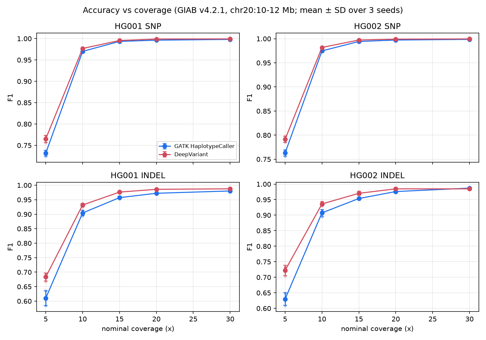
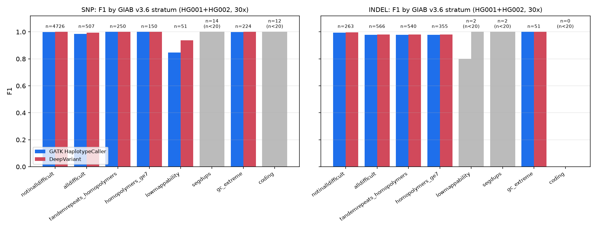
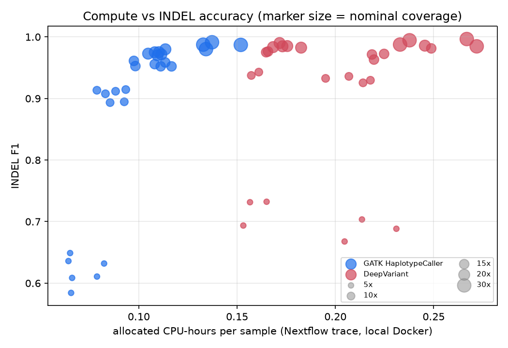

# Coverage, caller and genomic context in germline short-variant accuracy: a reproducible GIAB benchmark on a cloud-native Nextflow platform

*Yogvid Wankhede* · draft generated from repository outputs · 2026-11-23 · all numbers regenerate with `make research-analyze`

## Abstract

We benchmarked GATK HaplotypeCaller 4.7.0.0 and DeepVariant 1.10.0 inside a cloud-native
Nextflow platform, using four GIAB samples (HG001 and the HG002/HG003/HG004 trio) on a 2 Mb
window of chr20, with **28 alignments, 56 call sets and 448 pipeline tasks run as one Nextflow
execution**. At full depth (~30x) both callers are excellent and statistically
indistinguishable on the same truth variants. Pooled SNP F1 is 0.996–0.9996 across samples,
INDEL F1 is 0.980–0.997, and every exact McNemar test gives p ≥ 0.125. DeepVariant's advantage
appears as coverage falls and is significant in every replicate at 5x and 10x (all p ≤ 0.005).
Summed over three seeds at 5x, 306–361 truth SNPs are found only by DeepVariant, versus 19–20
found only by GATK. Errors are not
uniform: GIAB difficult regions cover 10% of the window and 9.7% of truth SNPs but hold
**94–100% of SNP errors**, and low-mappability SNPs are the weakest stratum (F1 0.85 GATK vs
0.94 DeepVariant, n = 51). A trio Mendelian analysis attributes 3 (GATK) and 1 (DeepVariant)
violations to the callers. A further 13 violations shared by all call sets and the independent
truth sets point to sample-level variants, not caller error. DeepVariant cost about 2.1x
GATK's allocated CPU per sample, and its cost barely falls with coverage. The same pipeline
run on AWS Batch (Spot, event-triggered) reproduced the local hap.py results exactly.

## 1. Introduction

Germline short-variant calling from Illumina WGS is mature, but the accuracy a lab actually
gets depends on choices that are often made by default: the caller, the sequencing depth,
and which parts of the genome are being judged. Single headline F1 scores hide all three
effects, and they come without a measure of uncertainty. This report benchmarks two widely
used callers (GATK HaplotypeCaller and DeepVariant) against Genome in a Bottle (GIAB) truth
sets. It is designed to answer four questions with uncertainty attached:

1. How much accuracy does each caller lose as coverage drops from 30x to 5x?
2. Is the difference between callers statistically distinguishable on the same variants?
3. Where in the genome do errors concentrate (GIAB difficult-region stratifications)?
4. Is the pipeline reproducible across reruns, thread counts and compute environments
   (laptop vs AWS Batch)?

## 2. Methods

### 2.1 Data
- **Reads.** 2×151 bp Illumina HiSeq X PCR-free WGS at ~30x for HG001 (NA12878) and the GIAB
  Ashkenazi trio HG002 (son), HG003 (father) and HG004 (mother). These come from the Google
  Brain Genomics public GRCh38 BAMs, restricted to **chr20:10,000,000-12,000,000** and
  converted back to paired FASTQ. Every sample is re-aligned from scratch, so the platform's
  own aligner is under test.
- **Reference.** UCSC hg38 chr20. The whole chromosome is indexed; calling is restricted to
  the 2 Mb window.
- **Truth.** GIAB **NISTv4.2.1** GRCh38 benchmark VCFs and confident-region BEDs, clipped to
  the window.
- **Stratifications.** GIAB genome-stratifications **v3.6** (GRCh38): all difficult regions
  and their complement, tandem repeats + homopolymers, homopolymers ≥7 bp, low mappability,
  segmental duplications, GC <25% or >65%, and RefSeq coding sequence.
- `research/scripts/fetch_research_data.sh` downloads everything and records SHA-256
  checksums (`data/research/SHA256SUMS`).

### 2.2 Pipeline
The platform's Nextflow DSL2 pipeline (`pipeline/`, v0.1.4): optional seeded downsampling
(seqtk 1.4) → fastp 1.4.0 → BWA-MEM2 2.2.1 (`-K 100000000`) → GATK 4.7.0.0 MarkDuplicates →
GATK HaplotypeCaller 4.7.0.0 **and** DeepVariant 1.10.0 (WGS model) on the same alignments →
bcftools 1.25 `norm -m -any` and a soft filter (GATK: `QUAL<30 || FORMAT/DP<5`; DeepVariant:
`FORMAT/DP<5` on top of its own PASS/RefCall) → hap.py 0.3.15 (xcmp engine, PASS calls only,
GIAB confident regions, stratified). Every container is pinned to an immutable tag. The
complete experiment is **one Nextflow run** driven by a samplesheet
(`research/scripts/make_matrix.py`).

### 2.3 Experimental design (pre-registered in `make_matrix.py` before results were seen)
- **Coverage titration.** HG001 and HG002 at full depth (~30x) plus read-pair fractions 1/6,
  1/3, 1/2 and 2/3 (nominally 5x, 10x, 15x, 20x), each with **3 independent seeds**.
- **Trio.** HG002, HG003 and HG004 at full depth.
- Each of the 28 alignments is called by both callers, giving **56 call sets**.

### 2.4 Statistics
- **Point metrics.** Recall = TP/(TP+FN) on truth variants; precision = TP/(TP+FP) on query
  variants; F1 is their harmonic mean. All come from hap.py.
- **Uncertainty.** Nearby variants are correlated (shared reads, repeats), so resampling
  individual variants understates variance. We use a **genomic block bootstrap**: the window is
  split into 40 blocks of 50 kb, and each of 2,000 replicates draws 40 blocks with replacement
  and pools their hap.py TP/FN/FP labels. Intervals are 95% percentile intervals
  (`gp_research.stats.block_bootstrap`, seed fixed).
- **Seed variability.** At each downsampled depth we report the mean and SD of F1 across the
  three seeds; this is sampling variance of the reads, which is distinct from the bootstrap.
- **Paired caller comparison.** On the *same* truth variants, each variant is found or missed
  by each caller. We test discordant pairs with an **exact McNemar test** (two-sided).
- **Truth-free consistency.** Mendelian violation rate in the trio, restricted to regions
  confident in all three truth sets. A missing call is treated as homozygous reference. The
  truth sets themselves serve as the method baseline.
- **Cost.** Allocated CPU-hours per sample × caller from the Nextflow trace (Σ realtime ×
  requested CPUs). Shared steps (downsampling, trimming, alignment, duplicate marking) are
  charged to both callers.
- **Reproducibility.** On the HG001 benchmark FASTQs: (R1) an identical run repeated; (R2)
  every task capped at 2 vs 8 CPUs; (R3) R2 without BWA-MEM2's fixed batch size; (R4) the AWS
  Batch run compared with the same inputs run locally. Comparison: identical sets of PASS
  biallelic genotypes.

All statistics code is in `research/analysis/src/gp_research`, with unit tests
(`make test-research`). Tables and figures are regenerated by `make research-analyze`.

## 3. Results

All values below come from `research/results/*.csv` (regenerated by `make research-analyze`).
"30x" is the full depth of the GIAB BAMs. Downsampled depths are nominal fractions of it.
Our bases-per-window estimate gives ~36.5x for the full data, an overestimate because reads
overlapping the window edges and duplicates are counted.

### 3.1 Accuracy at full depth, with uncertainty

Point estimates with 95% genomic-block-bootstrap intervals (50 kb blocks, 2,000 replicates).
The point estimates equal hap.py's own output exactly, which validates the per-variant parsing.

| Sample | Caller | SNP F1 [95% CI] | INDEL F1 [95% CI] |
|---|---|---|---|
| HG001 | GATK | 0.9981 [0.9954, 0.9998] | 0.9802 [0.9642, 0.9917] |
| HG001 | DeepVariant | 0.9992 [0.9974, 1.0000] | 0.9876 [0.9756, 0.9965] |
| HG002 | GATK | 0.9986 [0.9964, 1.0000] | 0.9871 [0.9737, 0.9978] |
| HG002 | DeepVariant | 0.9996 [0.9986, 1.0000] | 0.9847 [0.9698, 0.9961] |
| HG003 | GATK | 0.9985 [0.9969, 0.9996] | 0.9874 [0.9773, 0.9964] |
| HG003 | DeepVariant | 0.9989 [0.9980, 0.9996] | 0.9966 [0.9909, 1.0000] |
| HG004 | GATK | 0.9961 [0.9893, 0.9998] | 0.9913 [0.9843, 0.9975] |
| HG004 | DeepVariant | 0.9972 [0.9909, 1.0000] | 0.9946 [0.9891, 0.9989] |

The intervals overlap heavily within each sample. On the same truth variants (paired), the
callers disagree on only 1–9 variants per sample and type at 30x, and no difference is
significant (exact McNemar p = 0.125–1.0; `paired_mcnemar.csv`). DeepVariant is not uniformly
better: HG002 INDEL F1 is slightly higher for GATK (0.9871 vs 0.9847, n.s.).

### 3.2 Coverage titration (Figure 1)



Mean F1 over 3 seeds (SD in `titration.csv`):

| Nominal depth | HG001 SNP GATK / DV | HG001 INDEL GATK / DV | HG002 SNP GATK / DV | HG002 INDEL GATK / DV |
|---:|---|---|---|---|
| 5x | 0.732 / 0.765 | 0.610 / 0.683 | 0.763 / 0.791 | 0.630 / 0.722 |
| 10x | 0.970 / 0.977 | 0.904 / 0.932 | 0.975 / 0.982 | 0.908 / 0.936 |
| 15x | 0.993 / 0.996 | 0.957 / 0.976 | 0.994 / 0.997 | 0.954 / 0.970 |
| 20x | 0.996 / 0.999 | 0.972 / 0.986 | 0.997 / 0.999 | 0.976 / 0.985 |
| 30x | 0.998 / 0.999 | 0.980 / 0.988 | 0.999 / 1.000 | 0.987 / 0.985 |

- SNP accuracy saturates by about 15x. INDEL accuracy keeps improving to 20–30x.
- Seed-to-seed SD is small everywhere (≤ 0.026 F1, largest for INDELs at 5x), so these
  trends are not sampling noise.
- The paired tests show the caller gap is a **low-coverage phenomenon**:

| Depth | Paired McNemar p across 3 seeds × 2 samples (SNP and INDEL) |
|---|---|
| 5x | all ≤ 2.4×10⁻⁵ |
| 10x | all ≤ 0.005 |
| 15x | 5.2×10⁻⁴–1.0 |
| 20x | 0.002–1.0 |
| 30x | ≥ 0.125 |

### 3.3 Where the errors are (Figure 2)



Pooled over HG001 and HG002 at 30x (`strata.csv`):

| | Truth variants: difficult / not difficult | Errors (FN+FP) in difficult regions |
|---|---|---|
| SNP, GATK | 507 / 4,726 | **16 of 17 (94%)** |
| SNP, DeepVariant | 507 / 4,726 | **6 of 6 (100%)** |
| INDEL, GATK | 566 / 263 | 24 of 27 (89%) |
| INDEL, DeepVariant | 566 / 263 | 21 of 23 (91%) |

- **Outside difficult regions SNP calling is essentially perfect:** both callers find all
  4,726 SNPs, and GATK adds 1 false positive.
- **Low-mappability SNPs** are the weakest stratum: GATK F1 0.846 (7 FN, 9 FP) vs DeepVariant
  0.939 (5 FN, 1 FP), on only n = 51 truth SNPs.
- **INDEL errors** sit almost entirely in tandem repeats and homopolymers. These hold 540 and
  355 truth indels, with F1 ≈ 0.979 (GATK) and 0.981 (DeepVariant).
- Strata with fewer than 20 truth variants (segmental duplications, coding, low-mappability
  INDELs) are shown but not interpreted.

### 3.4 Trio Mendelian consistency

Restricted to regions confident in all three truth sets. All call sets and the truth were
normalised identically (`mendelian.csv`):

| Call set | Sites | Violations | Rate | Shared with truth | Caller-attributable |
|---|---:|---:|---:|---:|---:|
| GIAB v4.2.1 truth (normalised) | 4,210 | 13 | 0.31% | n/a | n/a |
| GATK HaplotypeCaller | 4,208 | 16 | 0.38% | 13 | **3** |
| DeepVariant | 4,195 | 14 | 0.33% | 13 | **1** |

All 13 truth violations are child-heterozygous SNVs absent from both parents. 10 of them
fall within 50 kb (chr20:11.13–11.18 Mb), far above the ~0.02 germline de novo SNVs
expected in 2 Mb. **Both callers independently reproduce all 13**, so the signal is in the
HG002 reads (consistent with cell-line-derived variation), not in calling.

The raw (unnormalised) GIAB truth VCFs gave a spurious 1.0% violation rate (43 sites) because
the same indel is written differently in different samples (e.g. `AAAAT>A` vs
`AAAATAAA>AAAAT`). Normalisation is required for any cross-sample comparison.

### 3.5 Compute cost (Figure 3)



- **Per sample:** allocated CPU-hours averaged **0.100 for GATK** (0.064–0.152) and **0.202
  for DeepVariant** (0.153–0.272). That is a DeepVariant/GATK ratio of 2.08 ± 0.45 (range
  1.57–3.23).
- **Scaling with depth:** GATK's cost scales with coverage (0.070 at 5x → 0.139 at 30x).
  DeepVariant's is nearly flat (0.19 → 0.25), dominated by fixed per-sample work.
- **Whole matrix:** 8.45 allocated CPU-hours, 1 h 18 m wall time on an 8-CPU laptop.
- **Cloud vs laptop:** on AWS Batch (Spot, 2-vCPU tasks) the single GATK run took 0.096
  allocated CPU-hours, but 88% of task wall time was scheduling, instance start-up, image pull
  and S3 staging (`RESULTS.md`). At this data size, per-task overhead, not compute, dominates
  cloud wall time.

### 3.6 Reproducibility

<!-- REPRO -->

## 4. Discussion

**Choosing a caller depends on coverage.** At ≥30x the two callers are statistically
indistinguishable on the same variants in this window, and GATK costs about half the CPU. A
lab sequencing at 30x would gain nothing measurable here from DeepVariant's extra compute. At
≤10x DeepVariant's advantage is large and consistent (at 5x, SNP F1 +2.8–3.3 points and
INDEL F1 +7.3–9.2 points), so for low-pass or degraded samples it is the better default.

**Headline F1 hides where errors are.** With 94–100% of SNP errors in 10% of the sequence,
a single genome-wide F1 mostly measures how much of a benchmark is easy. Stratified reporting,
which the pipeline now produces automatically when given a stratification directory, should
be standard for any accuracy claim, and the uncertainty in small strata must be shown.

**Truth-free QC needs a truth-calibrated floor.** Mendelian violation rates are a popular
production QC metric, but here more than 80% of the violations were shared with the truth
sets themselves. Without decomposing against an independent baseline, a lab would misattribute
sample-level variation to the caller.

**Engineering reproducibility is a research result too.** The cross-environment match (laptop
vs AWS), and the reproducibility experiments in §3.6 that show which settings control
determinism, are what make a pipeline's accuracy claims portable from development to
production.

## 5. Limitations

- **Small region.** 2 Mb of chr20 (≈ 3.1k SNPs and 0.4k INDELs per sample). The intervals
  are correspondingly wide, and several difficult strata have fewer than 20 truth variants. A
  whole-chromosome or whole-genome run would narrow them. The platform scales to that, but the
  cost cap ruled it out here.
- **One sequencing platform and library type** (HiSeq X, PCR-free, 2×151). Results may differ
  for NovaSeq, PCR+ libraries, exomes or long reads.
- **Simulated low coverage.** Downsampling a 30x library is not the same as sequencing at 5x
  (duplication structure and library complexity differ).
- **Default models and filters.** DeepVariant's WGS model and a simple GATK hard filter. We
  did not run VQSR or tune DeepVariant.
- **Truth-set bias.** GIAB v4.2.1 was built partly with short-read callers, so benchmark
  regions may under-represent exactly the contexts where callers disagree.
- **Allocated vs used CPU.** Costs are requested CPUs × task time. DeepVariant may not use all
  8 requested CPUs, so its ratio is an upper bound. Local timings ran under Rosetta 2
  emulation on Apple Silicon.
- **Single AWS run.** The cloud comparison is one sample, one caller and one run.

## 6. Data and code availability

Code: <https://github.com/yogvidwankhede/genomics-platform-aws> (MIT). Data are public GIAB
and Google Brain Genomics resources; `make research-data` fetches them. To regenerate
everything:

```bash
make research
```

That runs data → matrix → reproducibility runs → tables and figures, all locally with $0 of
cloud spend.

## References

1. Zook JM et al. *An open resource for accurately benchmarking small variant and reference calls.* Nat Biotechnol 37, 561–566 (2019).
2. Wagner J et al. *Benchmarking challenging small variants with linked and long reads.* Cell Genomics 2(5), 100128 (2022). (GIAB v4.2.1)
3. Krusche P et al. *Best practices for benchmarking germline small-variant calls in human genomes.* Nat Biotechnol 37, 555–560 (2019). (hap.py / GA4GH)
4. Poplin R et al. *A universal SNP and small-indel variant caller using deep neural networks.* Nat Biotechnol 36, 983–987 (2018). (DeepVariant)
5. Poplin R et al. *Scaling accurate genetic variant discovery to tens of thousands of samples.* bioRxiv 201178 (2018). (GATK HaplotypeCaller)
6. Di Tommaso P et al. *Nextflow enables reproducible computational workflows.* Nat Biotechnol 35, 316–319 (2017).
7. Dwarshuis N et al. *The GIAB genomic stratifications resource for human reference genomes.* Nat Commun (2024).
8. Vasimuddin Md et al. *Efficient architecture-aware acceleration of BWA-MEM for multicore systems.* IPDPS (2019). (BWA-MEM2)
9. Künsch HR. *The jackknife and the bootstrap for general stationary observations.* Ann Stat 17, 1217–1241 (1989). (block bootstrap)
